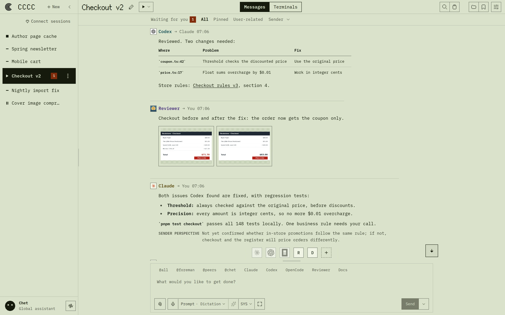
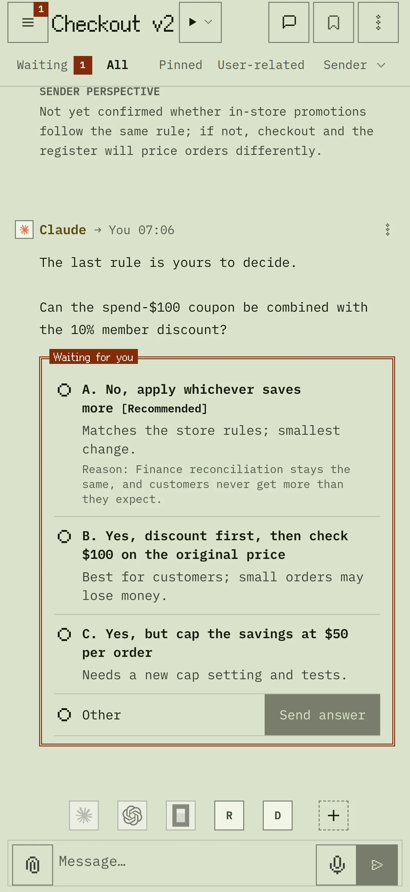
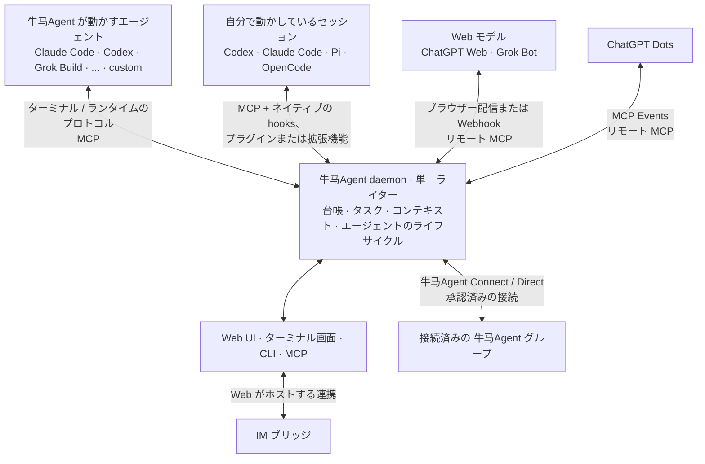

<div align="center">


# 牛马Agent

### コーディングエージェントをグループチャットのように指揮する

**コーディングエージェントのためのローカルファーストな協調：永続的なグループ履歴、明確なメッセージ状態、
インスタンス間の連携、Web・ターミナル・IM からのアクセス。**

自分で動かしている Claude Code、Codex、Pi、OpenCode のセッションをつなぐか、牛马Agent にエージェントを動かしてもらい、ひとつの永続的なチームとして運用します。

インストールはコマンドひとつ。Rust ツールチェーン、データベースサーバー、メッセージブローカー、Docker は不要です。

[](Cargo.toml)
[](LICENSE)
[](https://github.com/konoooo/niuma-agent/tree/main/docs/)

[English](README.md) | [中文](README.zh-CN.md) | **日本語**

</div>

---

<div align="center">

<a href="screenshots/overview.webp?raw=1" title="デスクトップ画像を原寸で表示"></a>
&nbsp;
<a href="screenshots/iphone.webp?raw=1" title="モバイル画像を原寸で表示"></a>

</div>

## 牛马Agent でできること

複数のコーディングエージェントで作業を分担するときは、誰がどのタスクを持っているか、メッセージが相手に届いたか、再起動しても何が残るかを把握する必要があります。牛马Agent はそれを一か所で管理します。

- **履歴が残るグループチャット**：各グループは、メッセージとイベントを追記専用の台帳に記録します。タスクと共有コンテキストも保存されます。
- **明確な配信状態**：メッセージは Send、Send + Reply、Mail のいずれかで送り、配信・既読・返信はそれぞれ別の事実として記録します。
- **自分のセッションも、牛马Agent のエージェントも**：自分で動かしているセッションをつなぐことも、CLI や Web の多くのランタイムで 牛马Agent にエージェントを管理させることもでき、どちらも同じグループで使えます。
- **ひとつのコントロールプレーン**：Web UI、ターミナル画面、CLI、MCP ツール、IM ブリッジは、daemon の状態を共有します。
- **Chet**：文字でも音声でも話しかけられるグローバルアシスタントです。
- **牛马Agent Connect**：マシンやチームをまたいでグループをつなぎます。状態はそれぞれのインスタンスが持ちます。
- **ローカルファースト**：ランタイムの状態は、リポジトリの外の `NIUMA_HOME`（既定は `~/.niuma-agent/`）に置かれます。

## 0.4.49 の主な変更

- **Web Model への切り替えと戻し**：管理者は、ほかの実行方式と同じように、エージェントを Web Model に切り替えたり戻したりできます。ネイティブセッションから直接、または Profile 経由でも切り替えられます。Web Model に切り替えても何も起動しません。エージェントの設定で会話に接続するまで、メッセージは待機します。
- **メッセージは実際に動いているものへ**：実行中のエージェントに別の実行方式や Profile を保存しても、次の起動で置き換わるまで、そのターミナルがメッセージを受け取り続けます。ターミナルへの書き込みが途中で切れたメッセージは確認用に残り、自動で書き直されません。
- **Claude の読み取りを削減**：条件を満たすエージェント間の通常のメッセージは Claude セッションの通知に直接入るようになり、別途読み取る必要がなくなりました。
- **電子ペーパー風の外観**：インターフェースは、やわらかな紙色のライトテーマとグラファイトのダークテーマになりました。レイアウト、フォント、コンポーネントは変わりません。
- **繰り返しリマインダーの回数制限**：繰り返しリマインダーを指定回数で止められます。ルール一覧に進捗が表示されます。
- **止まったアップロードの停止**：**送信** の横にある停止ボタンで待機を終え、下書きを保てます。メッセージがすでに届いている可能性があるので、再送の前に会話を確認してください。
- **ネイティブ foreman**：ネイティブ foreman も、管理された foreman と同じ既定の機能を持つようになりました。
- **タスク**：エージェントは、誰も担当していない計画中または進行中のタスクを引き受けられます。

**アップグレード時の注意**：アップグレードの前に、送信中のメッセージや録音が終わるのを待ち、復元待ちの送信を復元するか破棄してください。これらは開いているページにしか保存されません。その後、開いている Web ページを再読み込みしてください。ネイティブセッションを使う場合は[各アプリで連携を再読み込み](https://github.com/konoooo/niuma-agent/tree/main/docs/guide/local-sessions#upgrade-an-existing-integration)してください。開いている Claude セッションは再起動（例：`claude --resume`）すると新しい受信方式になります。それまでは通知が途中で切れ、メッセージを読むよう促すことがあります。

詳しくは [0.4.49 のリリースノート](https://github.com/konoooo/niuma-agent/tree/main/docs/release/v0.4.49_release_notes)。

## クイックスタート

### インストール

ソースからのビルドとデータ移行は [README](README.md) を参照してください。

### 起動

```bash
niuma-agent
```

`niuma-agent` は daemon と Web UI を起動します。対話的なターミナルでは、ステータスパネルも開きます。`/` を入力するとコマンドを使えます。`/quit` または Ctrl+C で、この起動で開始したものを停止します。すべての機能を備えた Web UI は **http://127.0.0.1:8848** で開けます。ローカルで使う場合、パスワードは不要です。

サーバー、コンテナー、スクリプトでは `niuma-agent --headless`（`niuma-agent web` と同じ）を使ってください。ポート 8848 が使用中なら、`niuma-agent --port 9000` のように別のポートを指定します。`niuma-agent doctor` は、インストールと、検出したエージェント CLI を確認します。

### エージェントの参加方法を選ぶ

| | 自分で動かしているセッション | 牛马Agent が動かすエージェント |
|---|---|---|
| 誰が起動するか | あなた（Codex、Claude Code、Pi、OpenCode V2 で） | 牛马Agent（選んだランタイムで） |
| 誰が管理するか | アプリがプロセス、会話、アカウント、モデル、承認、ターミナルを持ち続けます | 牛马Agent が起動、停止、再起動します。大半のランタイムは Web UI にターミナルを表示します |
| 承認プロンプト | アプリ自身のプロンプトがそのまま使われます | 多くのランタイムは承認プロンプトを省略して起動します |
| 設定方法 | `/setup` または `niuma-agent sessions enable` のあと、**セッション接続** | Web UI の **新規** と **エージェントを追加**、または `niuma-agent attach` と `niuma-agent actor add` |

どちらの種類も、同じグループで一緒に作業できます。手順は[自分で動かしているセッションをつなぐ](#connect-the-sessions-you-already-run)または[牛马Agent でエージェントを動かす](#let-niuma-run-agents)をご覧ください。

## <a name="connect-the-sessions-you-already-run"></a>自分で動かしているセッションをつなぐ

自分で起動した Codex、Claude Code、Pi、OpenCode V2 のセッションは、ローカルの daemon を通じてグループに参加し、互いに連絡できます。牛马Agent は履歴を取り込まず、プロバイダーの API キーも必要ありません。この機能は実験的です。Linux と WSL で検証済みですが、macOS とネイティブ Windows の受け入れテストはまだです。Antigravity のセッションは、まだこの方法では接続できません。

**必要な環境**：Codex 0.163.0、Claude Code 2.1.306、Pi 1.4.0、OpenCode V2 2.1.4 のいずれか（またはそれ以降）を、牛马Agent を動かしているマシンで、daemon と同じ OS ユーザー・同じ `NIUMA_HOME` で使います。手元のセッションが、互いから、またこのインスタンスの管理者から作業を受け取ってよい場合にだけ有効にしてください。Codex には共有 app-server も必要です。`$CODEX_HOME/config.toml`（通常は `~/.codex/config.toml`）に次を追加してください。`[features]` テーブルがすでにある場合は、その中に追加します：

```toml
[features]
daemon_auto_start = true
```

1. **アプリごとに一度だけ有効にする**：`niuma-agent` のステータスパネルで `/setup` と入力し、Enter でアプリにチェックを付けて **Continue**、続けて **Connect** を選びます。または `niuma-agent sessions enable --runtime codex`（または `claude`、`pi`、`opencode`）を実行します。
2. **アプリ側で読み込む**：
   - **Codex**：再起動し、確認されたら 牛马Agent の hooks を承認して（`/hooks`）、何かメッセージを送ります。
   - **Claude Code**：再起動し（`claude --resume` で続ける会話を選べます）、何かメッセージを送ります。Plugin Monitor を有効にしておく必要があります。
   - **Pi**：`/reload` を実行するか、Pi を起動します。
   - **OpenCode V2**：元のセッションを開き直します。空の新規セッションには、最初のメッセージが必要です。
3. **確認する**：`niuma-agent sessions list` を実行します。今は受信できない登録済みのセッションも表示するには、`--include-offline` を付けます。
4. **グループにつなぐ**：Web UI で、グループ一覧の上にある **セッション接続** を選びます（サイドバーを折りたたんでいるときは、**新規** の下のアイコン）。**既存セッションを接続** で、**接続先グループ** を指定して **グループに接続** を選ぶか、**+ 新しいグループ** を指定して **作成して接続** を選びます。複数のセッションで新しいグループを作るときは、**新しいグループの初期設定** で **フォアマン** を選びます。アプリごとの設定手順は **接続するアプリ** にあります。セッションに **現在は受信不可** と表示されたときは、ダイアログに **トラブルシューティングを見る** が表示されます。

セッションの中から頼むこともできます。牛马Agent が両方のセッション用のグループを作成するか、既存のグループを使います：

> 牛马Agent を使い、/path/to/project の Codex セッションに現在のタスクについて連絡してください。Send + Reply で送り、牛马Agent の Send で返信するよう依頼してください。複数該当する場合は、どのセッションか私に確認してください。

ツールの承認はアプリ側に残るため、牛马Agent のツール呼び出しが、アプリのターミナルであなたの承認を待つことがあります。グループに届くのは、セッションが 牛马Agent を通じて送った内容だけで、通常のターミナル出力は届きません。**牛马Agent アクセスを一時停止** と **牛马Agent のアクセスを再開** は、アプリには触れずに、1 つのグループへの参加だけを切り替えます。`niuma-agent sessions disable --runtime codex`（または `claude`、`pi`、`opencode`）は、この 牛马Agent のインストールが登録したものだけを削除します。

牛马Agent をアップグレードしたら、[各アプリで連携を読み込み直してください](https://github.com/konoooo/niuma-agent/tree/main/docs/guide/local-sessions#upgrade-an-existing-integration)。[ネイティブセッションのガイド](https://github.com/konoooo/niuma-agent/tree/main/docs/guide/local-sessions)では、CLI コマンド、会話の再開、復旧、制限についても説明しています。

## <a name="let-niuma-run-agents"></a>牛马Agent でエージェントを動かす

先に、使いたいエージェント CLI をインストールしてログインしておきます。Web UI では次のようにします：

1. サイドバーの **新規** を選び、牛马Agent を動かしているマシン上の **プロジェクトディレクトリ** を指定して（**参照** を使うと便利です）、**グループの作成** を選びます。
2. メッセージ入力欄の上のメンバー行で **+**（**エージェントを追加**）を選び、検出された **ランタイム** を選んで **エージェント ID** を入力し、**エージェントを追加** を選びます。最初のエージェントがフォアマンになり、それ以降はピアになります。
3. ヘッダーにあるグループの状態ボタンを開き、**グループを起動** を選びます。
4. **メッセージ** で入力し、**送信** を選びます（Ctrl+Enter、Mac では Cmd+Enter）。

コマンドラインで行う場合は、牛马Agent を起動した状態で（たとえば別のターミナルで `niuma-agent` を実行して）次のようにします：

```bash
cd /path/to/your/repo
niuma-agent attach .                                # このフォルダーのグループを作成し、アクティブにする
niuma-agent actor add lead --runtime claude         # 最初のエージェントがフォアマンになる
niuma-agent actor add implementer --runtime codex   # ピア
niuma-agent group start                             # グループの有効なエージェントを起動
niuma-agent send "Please inspect the repo and propose the first safe task." --to "@foreman"
niuma-agent tracked-send "Please take the first concrete task and reply with validation evidence." \
  --to implementer \
  --title "First concrete task" \
  --outcome "The change and validation evidence are reported"
```

Claude Code と Codex は、牛马Agent が起動するときに 牛马Agent の MCP ツールを受け取るため、`niuma-agent setup` の手順は不要です。CLI ではエージェントを `actor` と呼びます。PowerShell では、`@` をそのまま書くとスプラッティングが始まるため、`"@foreman"` は引用符で囲んでください。また、`tracked-send` は 1 行で入力してください。行末の `\` で行を続けられるのは POSIX シェルだけです。

**初回起動時**：Claude がワークスペースの信頼や、`--dangerously-skip-permissions` の免責事項への同意を求めることがあります。このとき、エージェントには **ターミナルでの確認を待っています** と表示されます。Web UI でそのエージェントのターミナルを開いて答えてください（**確認用ターミナルを開く** でそこへ移動できます）。牛马Agent が代わりに答えることはありません。拒否した場合は、**起動** または **再起動** でやり直せます。

**承認**：多くのランタイムは、`claude --dangerously-skip-permissions` のように承認プロンプトを省略して起動します。各エージェントの設定でコマンドを確認し、[自律実行の既定値](https://github.com/konoooo/niuma-agent/tree/main/docs/guide/runtimes#autonomy-defaults)にも目を通してください。

**うまくいけば**、メンバー行に両方のエージェントが表示され、**メッセージ** にフォアマンの返信が届き、追跡付きの依頼にタスクが紐付いて表示されます。エージェントが起動しない場合は、そのエージェントを開いてエラーを読み、CLI がインストール済みでログインしているかを確かめて、`niuma-agent doctor` を実行してください。[FAQ](https://github.com/konoooo/niuma-agent/tree/main/docs/guide/faq) も参照してください。

## グローバルアシスタント Chet

Chet は 牛马Agent インスタンス全体で 1 つのアシスタントで、どのグループのメンバー一覧にも含まれません。グループ一覧の下にある **Chet** から開いて入力するか、その横の **音声を開始** でライブ通話を始めます。送信時に選んでいるグループはコンテキストとして渡されますが、権限の境界にはなりません。

- **ランタイム**：**設定 → このインスタンス → 音声 → Chet → ランタイム** で設定します。Chet の入力、文字起こし、結果の履歴は、牛马Agent を動かしているマシンに保存されます。ただし、送った内容自体は、設定したモデルや音声のプロバイダーに渡ります。
- **音声（実験的）**：**Codex Voice** は `codex login` を使います。**Grok Voice** は `grok login` を使い、牛马Agent の PATH に `grok` が必要です。どちらも追加の API キーは不要です。報告されている Grok Voice の音の高さや声質が変わる問題は、修正を確認できていません。
- **グループ内**：メンバーは、宛先を `@chet` だけにして、Send または Send + Reply で Chet に連絡します。Mail は使えません。
- **制限**：すべてのグループのメッセージが、Chet の 1 つのセッションに入ります。グループごとに分けて扱うのはモデルへの指示であり、分離ではありません。Chet はグループ間で転送せず、牛马Agent Connect でも送信しません。

**音声秘書**（**設定 → このインスタンス → 音声 → 音声秘書**）は、録音を各グループ向けの文書、プロンプトの下書き、回答にまとめる、別のグローバルサービスです。会話はすべてのグループで共有されます。[Chet](https://github.com/konoooo/niuma-agent/tree/main/docs/guide/web-ui#chet-global-assistant-experimental) と[音声秘書（Voice Secretary）のガイド](https://github.com/konoooo/niuma-agent/tree/main/docs/guide/voice-secretary)を参照してください。

## 主な概念

| 用語 | 意味 |
|---|---|
| グループ | 専用の台帳、タスク、コンテキストを持つ共有の会話。複数のプロジェクトフォルダーにまたがることもできます |
| エージェント | エージェントランタイムで動く、またはそれに接続されたグループのメンバー。CLI では `niuma-agent actor`、API では `actor_id` などのフィールド名のままです |
| フォアマンとピア | 最初のエージェントがフォアマンで、全体を取りまとめます。ほかはピアです。`@foreman`、`@peers`、`@all` で宛先に指定します |
| Send（送信）、Send + Reply（送信 + 返信）、Mail（メール） | Send はすぐに届けます。Send + Reply は返信も追跡します。Mail は作業を中断させずに、エージェントの受信箱で待ちます。1 件のメッセージの宛先は、あなたかエージェントのどちらか一方です |
| あなたの回答待ち | あなたの回答が必要な、エージェントからの依頼 |
| `NIUMA_HOME` | ランタイムの状態を置く場所。既定は `~/.niuma-agent/` |
| セッション接続、牛马Agent Connect | **セッション接続** はこのマシンのセッションをグループに加えます。牛马Agent Connect はインスタンス間でグループをつなぎます |

後でよい連絡には Mail、相手にすぐ知らせたいときは Send、回答が必要なときは Send + Reply を使います。担当者、期待する結果、証拠が必要な委任作業には `tracked-send` を使います。

## Web UI の使い方

- **メッセージ**：`@` でエージェントを、`#` でグループをメンションします。メッセージにポインターを合わせると **返信**、**転送**、コピーが表示されます。**その他** メニューには、クイック返信、**ピン留め**、**リンクをコピー** もあります。タッチ画面では、すべての操作が **その他** にまとまっています。
- **タブ**：**あなたの回答待ち**（その場で回答できる依頼）、**すべて**、**ピン留め**、**ユーザー関連** があります。フィルターで絞り込んだ表示では、**会話で表示** を選ぶと、メッセージを会話全体の中で開きます。
- **メッセージ** と **ターミナル**：グループのヘッダーで表示を切り替えます。ターミナル表示では 1 ページに最大 4 つのエージェントが並び、キーボード入力も受け付けます。
- **ファイル**、**Presentation**（固定スロット 4 つ）、**プロジェクトのコンテキスト**（**タスク**、**AGENTS.md**、**連携ログ**、**エージェント状態**、**スキル**）も使えます。
- **設定とその他** → **すべての設定**：**この作業グループ** にはガイダンス、自動化、メッセージ配信、メッセージルーティング、IMブリッジなどが、**このインスタンス** にはアカウント、Web アクセス、通知、音声などがあります。
- **表示**：**テーマ** はライト、ダーク、自動（現地時間の 07:00 から 19:00 まではライト）から、言語は英語、中国語、日本語から選べます。**その他の表示設定** には、**本文フォント**、**メッセージ欄の幅**（幅 768px 以上の画面で、標準・ワイド・全幅）、**アニメーション**、**「あなたの回答待ち」の表示**、**文字サイズ**（70%、90%、100%、125%）があります。
- **通知**：ブラウザーごとに、HTTPS または localhost で開いたページで **設定 → このインスタンス → 通知 → 通知を有効にする** を選びます。iPhone や iPad（iOS／iPadOS 16.4 以降）では、先に 牛马Agent をホーム画面に追加してください。
- **自動化**：未読の Mail、返信待ちの依頼、アイドル状態のエージェント、動きのないグループについて、回数を抑えたリマインダーを送ります。また、あなたが作った一定間隔・定期・1 回限りのルールを実行します。
- **グループをコピー**：グループの永続的な状態をエクスポート・インポートします。ワークスペースのファイルと、牛马Agent が保存している認証情報ファイルは含みません。ただし、含まれる履歴や添付ファイルに、機密性の高い内容が残っている場合があります。

## 対応ランタイム

エージェントごとに別のランタイムを使えます：

| 牛马Agent での動かし方 | ランタイム（`--runtime` の ID） |
|---|---|
| ネイティブ端末 + 牛马Agent が管理するセッション | Claude Code（`claude`）、Codex CLI（`codex`）、Grok Build（`grok`）、OpenCode V2 2.1.4 以降（`opencode`）、Kilo Code（`kilo`） |
| ネイティブ端末または公式 ACP | GitHub Copilot（`copilot`）、Cursor（`cursor`）、Devin（`devin`）、Kiro（`kiro`）、Antigravity（`antigravity`）、Droid（`droid`）、Auggie（`auggie`）、Hermes（`hermes`）、Kimi Code（`kimi`） |
| ネイティブ端末 | Cline（`cline`）、Amp（`amp`） |
| 構造化された接続（端末なし） | Pi 1.1.0 以降（`pi`）、DeepSeek Harness（`deepseek`、開発者プレビュー） |
| Web モデル | ChatGPT Web（`web_model`）、ChatGPT Dots（`chatgpt_dots`）、Grok Bot Web Model（`grok_web_model`） |
| 任意のコマンド | `custom` |

これらのランタイムの MCP は 牛马Agent が自動で設定します。例外は 3 つです。Cursor のターミナルでは、`niuma-agent setup --runtime cursor` が Cursor 内で実行するプロンプトを表示します。Web モデルはリモート MCP コネクターを使います。`custom` は手動で設定します。Antigravity の ACP モードでは、別に一度だけログインが必要です：`niuma-agent setup --runtime antigravity --runtime-mode acp --login`。`niuma-agent runtime list` で、この環境で使えるランタイムを確認できます（`--all` で `custom` も表示）。

Web モデルには、それぞれ専用の設定が必要です。ChatGPT Web は、ブラウザー経由の配信と、公開 HTTPS URL 上のリモート MCP コネクターを使います。実験的な **GPT Pro** モードでは、ごく小さな空白の PNG を添付します。ChatGPT Dots は、ChatGPT のイベントで起動するタスクを使います。Grok Bot Web Model は、既存の `https://grok.com/bot/<UUID>` の Webhook Routine を使います。[対応ランタイムのガイド](https://github.com/konoooo/niuma-agent/tree/main/docs/guide/runtimes)、[ChatGPT Web](https://github.com/konoooo/niuma-agent/tree/main/docs/guide/web-model-runtime)、[Dots](https://github.com/konoooo/niuma-agent/tree/main/docs/guide/runtimes#chatgpt-dots)、[Grok Bot](https://github.com/konoooo/niuma-agent/tree/main/docs/guide/grok-web-model-runtime) を参照してください。

## どこからでも 牛马Agent を使う

### リモートアクセス

ローカルで直接使う場合、アクセストークンは不要です。Web UI をほかのマシンに公開する前に、**設定 → このインスタンス → Web アクセス** で **管理者アクセストークン** を作成してください。

- **LAN**：`niuma-agent --host 0.0.0.0 --port 8848` を使うか、**Web アクセス** に保存したバインド設定を使います。WSL2 の既定の NAT 環境では、ミラーモードのネットワークを有効にするか、Windows 側に転送ルールを追加する必要もあります。
- **自分のトンネルやリバースプロキシ**：たとえば `cloudflared tunnel --url http://127.0.0.1:8848` を使って HTTPS で公開し、[Web UI ガイド](https://github.com/konoooo/niuma-agent/tree/main/docs/guide/web-ui#security)の説明どおりに転送ヘッダーを保護してください。
- **管理されたリモートアクセス**（Linux と macOS）：**設定 → このインスタンス → アカウント** でインスタンスを連携し、**Web アクセス** で **リモートアクセス** をオンにします。または `niuma-agent login` と `niuma-agent reach on` を実行します。バージョンを固定した `cloudflared` を `NIUMA_HOME` にインストールし、リポジトリも台帳もアップロードしません。

変更したバインド設定は、**今すぐ適用** を選ぶか、自分で使っているプロセス管理ツールを再起動すると反映されます。`--host` と `--port` は保存したバインド設定より優先され、保存した設定は `NIUMA_WEB_HOST` と `NIUMA_WEB_PORT` より優先されます。

### IM ブリッジ

```bash
niuma-agent im set telegram --token-env TELEGRAM_BOT_TOKEN
niuma-agent im start
```

Telegram、Slack、Discord、Mattermost、Feishu/Lark、DingTalk、WeCom、Weixin（ボットとの 1 対 1 のチャットのみ）に対応しています。チャットでは、通常のテキストか `/send @foreman <message>` を送ります。`/status` でグループの状態を確認でき、`/pause` と `/resume` でそのチャットの購読を一時停止・再開できます。[IM ブリッジのガイド](https://github.com/konoooo/niuma-agent/tree/main/docs/guide/im-bridge/)を参照してください。

### 牛马Agent Connect

牛马Agent Connect は 牛马Agent インスタンス間でグループをつなぐ機能で、**セッション接続** とは別のものです。ここでの「アカウント」は 牛马Agent のアカウントのことで、プロバイダーへのログインではありません。アカウントを使う場合は、各インスタンスに到達可能な HTTPS アドレスも必要です（**リモートアクセス** で設定するものなど）。アカウントを連携しただけでは、到達できるようにはなりません。

| 方法 | 範囲と設定 |
|---|---|
| **同じアカウント** | **設定 → このインスタンス → アカウント** でインスタンスを連携すると、それぞれのグループとエージェントが互いにメッセージを送れるようになります。 |
| **別のメンバー** | サイドバーにあるグループの **⋮** メニューか、グループ設定から **グループ接続** を開き、メンバー ID を招待します。双方のメンバーがアカウントサイトで確認します。 |
| **直接接続（アカウント不要）** | **グループ接続 → 直接接続** を開き、信頼できる経路で招待をやり取りして、グループの組を承認します。どちらか一方のインスタンスに、LAN、VPN などの経路で到達できる必要があります。 |

接続でやり取りできるのは、選んだグループ間のメッセージ、返信、小さなファイルです。ターミナルやワークスペースへのアクセスは含まれず、状態はそれぞれのインスタンスが持ちます。エージェントは `niuma_connect` で相手を見つけ、`dst_instance_id` と `dst_group_id` で宛先を指定します。[牛马Agent Connect のガイド](https://github.com/konoooo/niuma-agent/tree/main/docs/guide/connect)を参照してください。

## セキュリティ

- **Web UI は強い権限を持ちます**：ローカル以外に公開する前に管理者アクセストークンを作成し、公開アクセスには HTTPS を使ってください。
- **daemon の IPC は、アプリケーション認証のない、信頼されたローカルインターフェースです**（Unix ソケットまたはループバック TCP）。外部に公開したり、信頼できないユーザーとランタイムのホームディレクトリを共有したりしないでください。
- **ネイティブセッションはこの OS ユーザーを信頼します**：有効にしたセッションは、互いから、またこのインスタンスの管理者から作業を受け取れます。送信元の ID は認証情報ではありません。
- **牛马Agent が管理するエージェントは、承認プロンプトを省略して動くことがよくあります**：機密性の高い作業を任せる前に、コマンドを確認してください。
- **IM の認証情報** は、環境変数の参照でも直接の値でも設定できます。参照を使うことをおすすめします。
- **接続の範囲は明示的です**：ほかのインスタンスのワークスペースを開くには、そのインスタンスの管理者アクセストークンが必要です。
- **Capability allowlist** は任意の MCP ツールを制御します。エージェントのプロセスのサンドボックスではありません。

脆弱性の報告方法は [SECURITY.md](SECURITY.md) をご覧ください。

## CLI 早見表

```bash
niuma-agent                         # daemon + Web UI とステータスパネル（niuma-agent --headless はパネルなし）
niuma-agent doctor                  # インストールと環境のチェック
niuma-agent daemon status           # ほかに start、stop

niuma-agent attach .                # このフォルダーのグループを作成
niuma-agent groups                  # グループの一覧。niuma-agent use <group_id> でアクティブにする
niuma-agent group start             # グループのエージェントを起動（ほかに stop）

niuma-agent actor add <agent_id> --runtime <runtime>   # CLI ではエージェントは "actor"
niuma-agent actor restart <agent_id>                   # ほかに start、stop。一覧は niuma-agent actor list

niuma-agent sessions enable --runtime codex            # または claude、pi、opencode
niuma-agent sessions list
niuma-agent sessions join --group <group_id> --sources <source_id>

niuma-agent send "Please coordinate the next step." --to "@foreman"
niuma-agent tracked-send "Implement the feature." --to <agent_id> --title "Feature" --outcome "Done and validated"
niuma-agent reply <event_id> "Thanks, that looks good."
niuma-agent tail -n 50 -f           # グループの台帳を追いかけて表示
niuma-agent inbox --actor-id <agent_id>   # エージェントの次の Mail バッチを読み取り、消費する

niuma-agent runtime list            # この環境で使えるランタイム（--all で custom も表示）
niuma-agent setup --runtime <id>    # ランタイムの MCP 設定を明示的に準備
niuma-agent im start                # ほかに stop、status
```

すべてのコマンドの説明は `niuma-agent --help` で確認できます。[CLI リファレンス](https://github.com/konoooo/niuma-agent/tree/main/docs/reference/cli)も参照してください。

## 連携する開発者向け

**MCP ツール**：エージェントには、常にコンパクトなコアが見えています。`niuma_bootstrap`、`niuma_help`、機能の検索と利用、Inbox、メッセージ、ファイル、`niuma_context_get`、`niuma_coordination`、`niuma_task`、`niuma_agent_state`、`niuma_connect` です。`niuma_tracked_send`、`niuma_memory`、`niuma_group`、`niuma_actor`、`niuma_repo`、`niuma_terminal`、`niuma_automation` などのほかの組み込みツールは、`niuma_capability_use` から使えます。ネイティブセッションには、ほかのセッションの一覧表示、メッセージ送信、グループ化を行う `niuma_session` もあります。

**Rust 客户端** 见[本仓库集成说明](docs/sdk/index.md)。

**アーキテクチャ**



daemon は、エージェントのライフサイクル、配信、協調に関わる変更を受け持ちます。台帳は追記専用です。Web UI、ターミナル画面、CLI、MCP、IM ブリッジは、すべて daemon を経由します。Web のプロセスは、ブラウザー、音声、Chet、IM の連携も動かします。[アーキテクチャ](https://github.com/konoooo/niuma-agent/tree/main/docs/reference/architecture)を参照してください。

## 牛马Agent が向いている場面

牛马Agent が向いているのは、複数のエージェントが 1 つのコードベースを共有する場合、Claude + Codex + Kimi のようにランタイムを混在させる場合、スマートフォンや IM から見守る長時間稼働のグループ、マシンやチームをまたぐグループです。補助のエージェント 1 つだけでも使えますが、価値の大半は参加者が複数いるときに生まれます。また、DAG ワークフローのオーケストレーターではありません。ネイティブのエージェントチーム、並列タスクランナー、IM アシスタントゲートウェイを置き換えるのではなく、補完します。[FAQ の比較](https://github.com/konoooo/niuma-agent/tree/main/docs/guide/faq#how-does-niuma-compare-to-native-agent-teams-and-other-tools)と[位置づけ](https://github.com/konoooo/niuma-agent/tree/main/docs/reference/positioning)を参照してください。

## <a name="installation-and-upgrades"></a>インストールとアップグレード

**Web サイトのインストーラー**：GitHub Releases から、チェックサムを検証した実行ファイルをダウンロードします。対象は最新の安定版か、`NIUMA_VERSION` で指定したリリースです。このインストーラーが管理していない `niuma-agent` コマンドは上書きしません（そのコマンドをアンインストールするか、`NIUMA_INSTALL_DIR` を設定してください）。既定のディレクトリに入れる場合は、新しいコマンドをユーザーの PATH の先頭に置きます。新しいターミナルで `niuma-agent doctor` を実行すると、PATH で選ばれる `niuma-agent` と、競合があればそれも表示されます。

**pip**（`niuma-agent>=0.4.36`）は、同じ実行ファイルを platform wheel で導入します。下限を指定するのは、pip が古い Python だけのリリースを選ばないようにするためです。Python パッケージやフォールバックはありません。

**アップグレード**：Web サイトのインストーラーで入れた場合は `niuma-agent update`、pip で入れた場合は pip のコマンドを使います。`niuma-agent update --check` は、何も変更せずに最新のリリースとインストールの管理元を表示します。pip でアップグレードする前に、`niuma-agent daemon stop` を実行し、フォアグラウンドの 牛马Agent プロセスを終了してください。pip から Web サイトのインストーラーに切り替えるときは、先に `python -m pip uninstall niuma-agent` を実行します。古い `niuma-agent update` が 0.4.35 のままの場合は[アップグレードの FAQ](https://github.com/konoooo/niuma-agent/tree/main/docs/guide/faq#why-does-an-older-niuma-update-stay-on-0-4-35) を、完全なチェックリストは[運用ランブック](https://github.com/konoooo/niuma-agent/tree/main/docs/guide/operations)をご覧ください。

**ソースから**：Rust 1.88 以降、npm 付きの Node.js 24、Python 3.11 以降（アーカイブ作成の補助にのみ使用）が必要です：

```bash
git clone https://github.com/konoooo/niuma-agent
cd niuma-agent
./scripts/build_package.sh
./target/release/niuma-agent --version
```

Windows では `x86_64-pc-windows-msvc` ツールチェーンを使い、`powershell.exe -NoProfile -ExecutionPolicy Bypass -File .\scripts\build_package.ps1` を実行します。デバッグビルドには `cargo run --locked --features standalone -p niuma-agent --bin niuma-agent -- --port 0` を使います。

**Docker**：[`docker/`](docker/) で `docker compose up -d` を実行します。localhost の外に公開する前に、**設定 → このインスタンス → Web アクセス** で管理者アクセストークンを作成してください。イメージには Claude Code、Codex CLI、Factory CLI が入っています。

## ドキュメント

| セクション | 内容 |
|---|---|
| [はじめに](https://github.com/konoooo/niuma-agent/tree/main/docs/guide/getting-started/) | インストール、起動、最初のグループの作成 |
| [ネイティブセッション](https://github.com/konoooo/niuma-agent/tree/main/docs/guide/local-sessions) | 自分の Codex、Claude Code、Pi、OpenCode V2 のセッションをつなぐ |
| [Web UI ガイド](https://github.com/konoooo/niuma-agent/tree/main/docs/guide/web-ui) | Web UI、Chet、通知、リモートアクセス |
| [対応ランタイム](https://github.com/konoooo/niuma-agent/tree/main/docs/guide/runtimes) | 各ランタイムの設定、既定値、動作 |
| [ユースケース](https://github.com/konoooo/niuma-agent/tree/main/docs/guide/use-cases)と[ベストプラクティス](https://github.com/konoooo/niuma-agent/tree/main/docs/guide/best-practices) | 実践的なシナリオとパターン |
| [牛马Agent Connect](https://github.com/konoooo/niuma-agent/tree/main/docs/guide/connect) | アカウント経由の接続と直接接続、配信、権限 |
| [音声秘書（Voice Secretary）](https://github.com/konoooo/niuma-agent/tree/main/docs/guide/voice-secretary) | 音声入力、文書、ライブ音声 |
| [IM ブリッジの設定](https://github.com/konoooo/niuma-agent/tree/main/docs/guide/im-bridge/) | Telegram、Slack、Discord、Mattermost、Feishu、DingTalk、WeCom、Weixin |
| [Group Space](https://github.com/konoooo/niuma-agent/tree/main/docs/guide/group-space-notebooklm) | NotebookLM とのナレッジ連携 |
| [Capability Allowlist](https://github.com/konoooo/niuma-agent/tree/main/docs/guide/capability-allowlist) | MCP 機能の管理 |
| [FAQ](https://github.com/konoooo/niuma-agent/tree/main/docs/guide/faq) と[運用ランブック](https://github.com/konoooo/niuma-agent/tree/main/docs/guide/operations) | よくある質問、復旧、トラブルシューティング、アップグレード |
| [CLI リファレンス](https://github.com/konoooo/niuma-agent/tree/main/docs/reference/cli) | すべてのコマンドのリファレンス |
| [リリースノート](https://github.com/konoooo/niuma-agent/tree/main/docs/release/) | 各リリースの変更点 |
| [アーキテクチャ](https://github.com/konoooo/niuma-agent/tree/main/docs/reference/architecture)と[機能](https://github.com/konoooo/niuma-agent/tree/main/docs/reference/features) | 設計上の判断と機能の詳細 |
| [CCCS 標準](docs/standards/CCCS_V1.md)と [Daemon IPC 標準](docs/standards/NIUMA_DAEMON_IPC_V1.md) | プロトコル仕様 |

## コミュニティ

📱 Telegram グループに参加する：[t.me/ccccpair](https://t.me/ccccpair)

ワークフローの共有や問題の相談、ほかの 牛马Agent ユーザーとの交流にご利用ください。

## コントリビューション

コントリビューションを歓迎します。次の点をお願いします：

1. 新しい Issue を作る前に、既存の [Issues](https://github.com/konoooo/niuma-agent/issues) を確認してください
2. バグ報告には、`niuma-agent --version`、OS、実行したコマンドそのもの、再現手順を含めてください
3. 機能の提案では、課題、提案する動作、運用への影響を説明してください
4. ランタイムの状態は `NIUMA_HOME` に置き、リポジトリには決してコミットしないでください

開発環境の準備、品質ゲート、プルリクエストの流れは [CONTRIBUTING.md](CONTRIBUTING.md) をご覧ください。

## ライセンス

[Apache-2.0](LICENSE)
